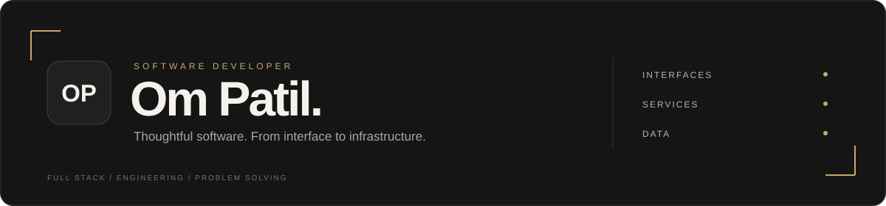
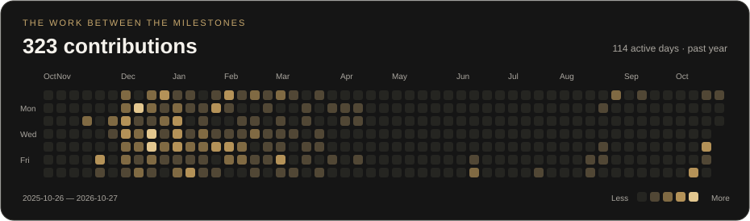

  

  

  <a href="https://ompatil.site"><strong>Explore portfolio ↗</strong></a>
  &nbsp;&nbsp; / &nbsp;&nbsp;
  <a href="https://www.linkedin.com/in/om-patil-57820a248/">LinkedIn</a>
  &nbsp;&nbsp; / &nbsp;&nbsp;
  <a href="https://leetcode.com/u/ompatilll/">LeetCode</a>
  &nbsp;&nbsp; / &nbsp;&nbsp;
  <a href="mailto:ompatilll.001@gmail.com">Get in touch</a>

 

<table>
<tr>
<td width="65%" valign="top">

THE DEVELOPER BEHIND THE CODE

<h3>I like making the pieces work together.</h3>

The interface, the API, the database—the interesting part is how they connect.

I’m a <strong>Full-Stack Software Developer</strong> building responsive
applications and reliable backend workflows with
<strong>React, TypeScript, Node.js, and PostgreSQL</strong>.

I care about software that’s straightforward to use, understand, and maintain.

</td>
<td width="35%" valign="top">

CURRENT CONTEXT

<strong>Building professionally</strong> 
Junior Software Developer · JoinWith

<strong>Engineering foundation</strong> 
B.Tech CSE · VIT · 2026

<strong>Academic record</strong> 
8.47 / 10 CGPA

<strong>Practising the fundamentals</strong> 
Data structures &amp; algorithms · C++

</td>
</tr>
</table>

 

## The workbench

> A few things I’ve taken from an idea to a working application.

<table>
<tr>
<td width="50%" valign="top">

01 / CONVERSATIONS, CONNECTED

<h2>ZenChat</h2>

<strong>A message should feel instant.</strong>

A full-stack messaging application connecting real-time conversations
with secure access and asynchronous message handling.

<pre>
  SIGN IN
     │
     ▼
  CONNECT  ←────→  EXCHANGE
     │               │
     └───────┬───────┘
             ▼
      ASYNC PROCESSING
</pre>

<ul>
  <li>Instant communication through Socket.io.</li>
  <li>OTP login and JWT authentication.</li>
  <li>Session management and REST APIs.</li>
  <li>RabbitMQ with consumer reconnection handling.</li>
</ul>

<strong>Delivered with</strong> 
React · Node.js · Express · Socket.io · RabbitMQ

 

<a href="https://zenchat.online"><strong>Open application ↗</strong></a>
&nbsp; · &nbsp;
<a href="https://github.com/ompatil-711/ZenChat">Source code →</a>

</td>
<td width="50%" valign="top">

02 / INFORMATION INTO ACTION

<h2>Agro-Aid</h2>

<strong>Useful information belongs within reach.</strong>

A responsive agriculture platform bringing weather forecasts,
multilingual support, and recommendation interfaces together.

<pre>
  WEATHER       USER INPUT
     │               │
     ▼               ▼
  FORECASTS     PREDICTION APIs
     │               │
     └───────┬───────┘
             ▼
      ACCESSIBLE INTERFACE
</pre>

<ul>
  <li>Responsive layouts and validated input forms.</li>
  <li>Live weather and five-day forecasts.</li>
  <li>Crop and fertilizer prediction API integration.</li>
  <li>Multilingual support through Google Translate.</li>
</ul>

<strong>Delivered with</strong> 
HTML · CSS · JavaScript · REST APIs

 

<a href="https://ompatil-711.github.io/Agro-Aid-Portfolio/"><strong>Open application ↗</strong></a>
&nbsp; · &nbsp;
<a href="https://github.com/ompatil-711/Agro-Aid-Portfolio">Source code →</a>

</td>
</tr>
</table>

<strong>Open the engineering notes</strong>

 

### ZenChat / Keeping conversations moving

- Built bidirectional communication using Socket.io.
- Developed REST APIs for user and message management.
- Implemented OTP-based login, JWT authentication, and session management.
- Integrated RabbitMQ for asynchronous messaging with consumer reconnection handling.
- Deployed the frontend and backend on Vercel and Render.

### Agro-Aid / Connecting information to an interface

- Led frontend development and responsive layout implementation.
- Integrated OpenWeatherMap for live weather and five-day forecasts.
- Connected crop and fertilizer forms to backend prediction APIs using Fetch.
- Added form validation and multilingual support.

  <a href="https://github.com/ompatil-711?tab=repositories">
    More repositories, experiments, and things built →
  </a>

 

## Tools behind the work

  

 

<table>
<tr>
<td width="33%" valign="top">

<h3>The interface</h3>

<em>Where the system meets its user.</em>

<strong>React · TypeScript · JavaScript</strong> 
HTML5 · CSS3 · React Bootstrap · Vite

Responsive layouts, reusable components, form validation,
and frontend-backend integration.

</td>
<td width="34%" valign="top">

<h3>The machinery</h3>

<em>Where requests become results.</em>

<strong>Node.js · Express · Socket.io</strong> 
RabbitMQ · ExcelJS · PDFKit

REST APIs, authentication, asynchronous messaging,
Excel imports, and PDF reporting.

</td>
<td width="33%" valign="top">

<h3>The foundation</h3>

<em>Where structure supports the work.</em>

<strong>PostgreSQL · TypeORM · SQL</strong> 
MongoDB · MySQL · C++

Data modeling, transactions, database queries,
and problem-solving fundamentals.

</td>
</tr>
</table>

<strong>Access, tooling &amp; delivery</strong>

 

| Concern | My toolkit |
| :--- | :--- |
| Identity & access | JWT, OTP verification, RBAC, session management |
| API protection | Rate limiting |
| Development workflow | Git, GitHub, Postman |
| Deployment | Vercel, Render |
| Core concepts | Data structures & algorithms, OOP, DBMS, database transactions |

 

## From learning to delivering

**JoinWith · Full-stack development**

<pre>
  MARCH 2026
      │
      ●  Full Stack Developer Intern
      │  Remote · March–June 2026
      │
  JUNE 2026
      │
      ●  Junior Software Developer
      │  Nagpur · Onsite
      │
      ↓  Present
</pre>

Working across **React 19, TypeScript, Node.js, Express 5, and PostgreSQL**,
with experience in:

- Business interfaces and REST API integration.
- Authentication, authorization, and API rate limiting.
- Transaction-backed database workflows.
- Bulk Excel imports and PDF invoice generation.
- Frontend-backend coordination and feature testing.

<strong>A little beyond the job title</strong>

 

### Engineering education

**Vellore Institute of Technology**  
B.Tech in Computer Science and Engineering  
October 2026 · CGPA **8.47/10**

### Formal learning

**SmartBridge**  
Full Stack Web Development — MERN Stack

### Community work

**Social Volunteer · December 2025**

Participated in organic farming and vermicomposting awareness
activities across five villages in Jalna.

### Event leadership

**Marathi Club, VIT · 2024–2025**

Managed logistics and vendors for a cultural festival with
500+ attendees, achieving a 15% budget surplus.

 

## Small steps. Visible progress.

I practise <strong>data structures and algorithms in C++</strong>
and continue developing my understanding of backend architecture
and system design.

  

  <a href="https://github.com/ompatil-711?tab=overview"><strong>GitHub activity ↗</strong></a>
  &nbsp; · &nbsp;
  <a href="https://leetcode.com/u/ompatilll/"><strong>Problem-solving ↗</strong></a>
  &nbsp; · &nbsp;
  <a href="https://ompatil.site"><strong>Portfolio &amp; projects ↗</strong></a>

 

---

THE NEXT THING DOESN’T EXIST YET

<h2>Maybe we should build it.</h2>

A software development opportunity, a project, 
or an interesting problem to think through.

<a href="mailto:ompatilll.001@gmail.com"><strong>Start a conversation ↗</strong></a>

 

<a href="https://ompatil.site">ompatil.site</a>
&nbsp; · &nbsp;
<a href="https://www.linkedin.com/in/om-patil-57820a248/">LinkedIn</a>
&nbsp; · &nbsp;
<a href="https://github.com/ompatil-711?tab=repositories">Repositories</a>

